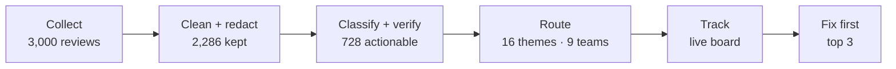
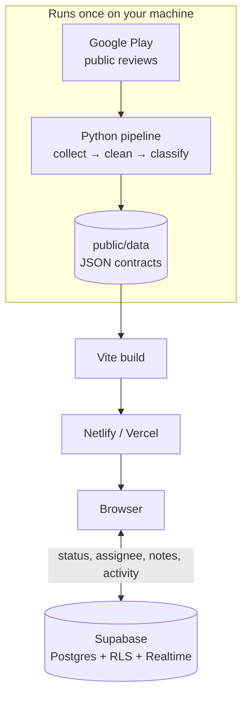
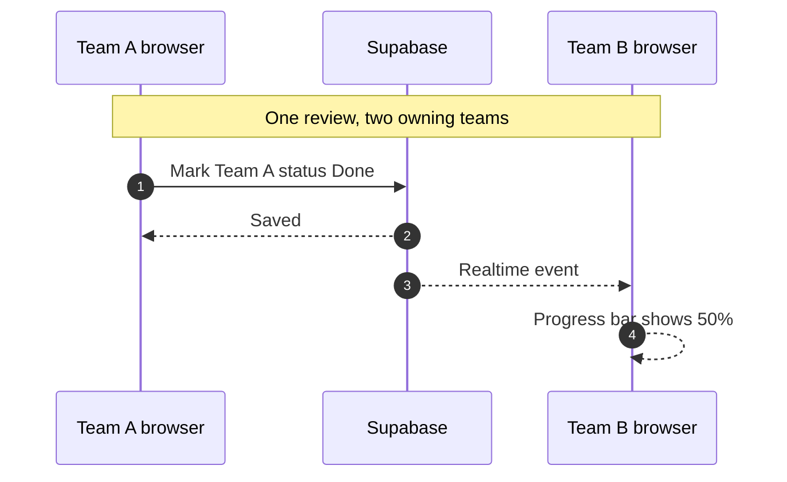
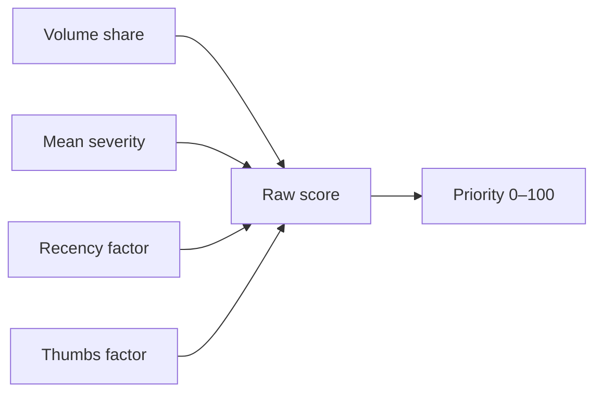

# HW Review-Fix Board

**3,000 reviews collected · 2,286 cleaned · 728 actionable · 16 themes · 9 teams.**

An independent, unofficial analysis of public Google Play reviews for Hitwicket. It turns player complaints into ranked, owned work with live status tracking.

> Not affiliated with, endorsed by, or sponsored by Hitwicket.

[Run it](#run-it) · [Guided tour](#guided-tour) · [How it works](#how-it-works) · [Deploy](#deploy) · [Limits](#limits)


---

## What it is

From review to fix: **find the repeated problems, quote the player, route the fix, track the work.**



Every on-screen quote is a verified verbatim substring of its review. Every issue has one to three owning teams. A shared issue shows one segmented progress bar.

---

## Run it

**Prerequisites:** Node.js 20+ and npm. Python 3.11+ is only needed to rebuild the data.

```bash
git clone https://github.com/SarvyagyaPrakash/hw-review-fix-board.git
cd hw-review-fix-board
npm install
npm run dev
```

Open **http://localhost:5173**. The committed `public/data` is enough to browse. No keys are needed for local-only mode.

## Guided tour

1. Open the **Board** and pick a team in the sidebar.
2. Read a card: problem, player quote, severity, and owners.
3. Change a status from **To do** to **Working** or **Done**.
4. Open a second browser window. Change a status in one; the other updates live.
5. Open **Fix first**. The score inputs, evidence, and suggested experiment are visible. Print it.

---

## Pages

| Route | Page | What you can do |
|---|---|---|
| `/` | **Board** | Filter by team, status, theme, severity, and stars. Update status and notes. |
| `/fix-first` | **Fix first** | Read the top 3 fixes, the scoring inputs, quotes, and AI-suggested experiments. |
| `/insights` | **Insights** | See theme volume, trends, severity mix, and star distribution. |
| `/explorer` | **Explorer** | Search every review, filter the set, and download a CSV. |
| `/about` | **About** | Read the method, taxonomy, formula, and limits. |

---

## What the data says

| Fact | Value |
|---|---|
| App id | `cricketgames.hitwicket.strategy` |
| Reviews collected | 3,000 |
| After cleaning | 2,286 |
| Actionable reviews | 728 |
| Themes / teams | 16 / 9 |
| Review window | 10 Feb 2024 – 15 Nov 2026 |
| Star split (cleaned set) | 869 one-star · 810 two-star · 607 three-star |

Cleaning drops 712 reviews under four words and 2 exact duplicates. Sources: [`meta.json`](public/data/meta.json) for counts and dates, [`insights.json`](public/data/insights.json) for the star split.

> **Top finding:** **Matchmaking Balance** ranks first with priority **100** and **205** reviews. The theme covers unfair pairings and large squad-rating gaps. See `/fix-first` for the quotes and score inputs.

| # | Theme | Priority | Reviews | Confidence |
|---|---|---|---|---|
| 1 | Matchmaking Balance | 100 | 205 | High |
| 2 | Pay To Win Sentiment | 60 | 95 | Medium |
| 3 | Ads & Notifications | 34 | 74 | Medium |

This is the ranking in the committed dataset. Source: [`public/data/insights.json`](public/data/insights.json).

---

## How it works

### 1. The pipeline runs once, locally



The deployed site never scrapes Google and never calls Google. It reads static JSON. Only team status, assignee, notes, and activity are shared through Supabase.

- **Collect:** public 1–3 star reviews, paced politely, once.
- **Clean:** drop short text and duplicates, redact emails, phones, UPI handles, URLs, and long digit strings.
- **Classify:** assign themes, severity, and a short problem line. Drop any quote that is not verbatim.
- **Route:** map themes to teams from a frozen taxonomy. The LLM never assigns teams.
- **Export:** validate every JSON file against a schema before deploy.

### 2. Realtime is a small loop



Design target: under 2 seconds. Without Supabase variables, the app runs in local-only mode and shows “Shared sync is off”.

### 3. Priority is a visible formula, not a black box



```text
raw      = volume_share × severity_norm × recency_factor × engagement_factor
priority = round(100 × raw ÷ max(raw over all themes))
```

Every input is shown on the Fix first page. Confidence is **High** when a theme has at least 100 reviews and AI-label agreement F1 of at least 0.75, **Medium** at 40+ reviews, otherwise **Low**.

---

## Teams and routing

Nine teams own the work. Each theme maps to one to three teams; the first team is primary.

<details>
<summary><strong>Show the 16 themes and their owners</strong></summary>

| Theme | Primary owner | Also owns |
|---|---|---|
| Onboarding Confusion | Product Analyst | UI/UX Designer, Product Associate |
| Tutorial Length & Flow | Product Associate | Growth Analyst |
| Auction Mechanics | Game Developer | UI/UX Designer, Product Associate |
| Lag & Performance | Software Engineer | Data Analyst |
| Crashes & Bugs | Software Engineer | Product Analyst |
| Pay To Win Sentiment | Game Developer | Product Analyst, Founder’s Office |
| Matchmaking Balance | Data Analyst | Game Developer |
| Pricing & Shop UX | UI/UX Designer | Product Associate, Data Analyst |
| Ads & Notifications | Growth Analyst | Marketing Associate, Product Associate |
| Support & Refunds | Founder’s Office | Product Associate, Data Analyst |
| Localisation & Regional | Marketing Associate | Product Associate |
| Social & Multiplayer | Product Associate | Growth Analyst, Marketing Associate |
| Release & Update Quality | Software Engineer | Founder’s Office |
| Progression & Grind | Game Developer | Product Analyst |
| Account & Data Loss | Software Engineer | Founder’s Office |
| Other Actionable Feedback | Product Analyst | — |

Source: [`public/data/taxonomy.json`](public/data/taxonomy.json).

</details>

---

## Quality and disclosure

- **Evidence:** the pipeline discards any quote that is not an exact substring of the redacted review.
- **Privacy:** reviewer names and user ids are never stored. Aliases use a salted hash. PII is redacted.
- **Evaluation:** 88% overall agreement with independent AI labels on a 75-review test split. Cohen’s κ is 0.80; macro-F1 is 0.52. This is **not** human-verified accuracy.
- **AI disclosure:** experiments are labelled “AI-suggested”. The site does not claim causal impact or uplift.
- **Replies:** most public reviews have no developer reply, so reply metrics are marked “Not available”.

---

## Deploy

1. **Database:** open the Supabase SQL Editor and run [`supabase/schema.sql`](supabase/schema.sql).
2. **Site:** import the repository into Netlify (`netlify.toml`) or Vercel (`vercel.json`). Both configs set the SPA rewrite.
3. **Keys:** add `VITE_SUPABASE_URL` and `VITE_SUPABASE_PUBLISHABLE_KEY`, then redeploy.

Full walkthrough: [`docs/DEPLOY_CHECKLIST.md`](docs/DEPLOY_CHECKLIST.md). Without the two Supabase variables, the deployed site still works in local-only mode.

---

## Rebuild the data

<details>
<summary><strong>Commands, outputs, and environment variables</strong></summary>

```bash
make setup
cp .env.example .env   # add GROQ_API_KEY
make all
```

`make all` re-collects reviews, so live Play counts may differ from the snapshot above. Collection is paced and slow by design.

| Command | Output |
|---|---|
| `make collect` | `data/raw/reviews_raw.jsonl` |
| `make clean` | `data/processed/reviews_clean.jsonl` |
| `make discover` | `pipeline/taxonomy.json` |
| `make classify` | `data/processed/reviews_classified.jsonl` |
| `make experiments` | `public/data/experiments.json` |
| `make evaluate` | `public/data/eval.json` |
| `make export` | `public/data/*.json` |
| `make test` | Pytest + Vitest results |
| `make web-build` | `dist/` production bundle |

| Variable | Needed for | Notes |
|---|---|---|
| `GROQ_API_KEY` | Re-running LLM steps and the optional Q&A endpoint | Server-side only |
| `GROQ_MODEL` | LLM steps | Default: `qwen/qwen3.8-27b` |
| `VITE_SUPABASE_URL` | Live sync | Browser-safe |
| `VITE_SUPABASE_PUBLISHABLE_KEY` | Live sync | Browser-safe, protected by RLS |
| `CHAT_ENABLED` | Optional Q&A endpoint | Default: `false` |
| `RATE_SALT` | Optional Q&A rate limiting | Server-side only |

</details>

<details>
<summary><strong>Repository map</strong></summary>

```text
.
├── src/                  React app and pages
├── public/data/          Deployed JSON contracts
├── pipeline/             Python: collect → clean → classify → export
├── scripts/              Background art and memo generation
├── supabase/             schema.sql, tests.sql, setup guide
├── netlify/functions/    ask.ts, optional Q&A
├── tests/                Pytest fixtures and tests
├── docs/                 Method, runbook, decisions, evaluation
├── data/                 Raw (git-ignored) and processed data
├── netlify.toml          Netlify build, headers, CSP
└── vercel.json           Vercel SPA rewrite and headers
```

</details>

---

## Limits

- **Scope:** 1–3 star reviews only. The data shows friction, not what retains happy players.
- **Language:** English and Latin-script Hinglish. Devanagari-dominant reviews were filtered out.
- **Sample:** 2,286 reviews survived cleaning; 728 were actionable.
- **Evaluation:** agreement with AI labels is not human verification.

---

## Docs

| Document | Why read it |
|---|---|
| [METHODOLOGY](docs/METHODOLOGY.md) | Collection, cleaning, taxonomy, evidence checks, scoring |
| [TAXONOMY](docs/TAXONOMY.md) | All 16 themes with definitions and owners |
| [EVAL_REPORT](docs/EVAL_REPORT.md) | Agreement results and top confusions |
| [RUNBOOK](docs/RUNBOOK.md) | Every command with expected output |
| [DECISIONS](docs/DECISIONS.md) | Trade-offs and alternatives |
| [MEMO](docs/MEMO.md) | The written product argument |

---

Built by **Sarvyagya Prakash** (B.Tech Computer Science, AI/ML) as an independent portfolio project for a Product Analyst role at Hitwicket. Not affiliated with Hitwicket.
